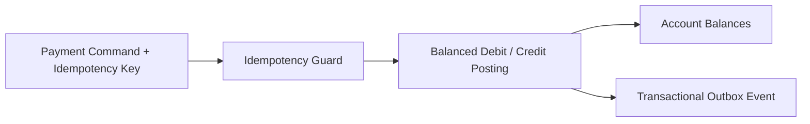

# Transactional Double-Entry Payment Ledger (Java 21)


**Stack:** `Java 21 · Double-Entry Accounting · Idempotency · Transactional Outbox`

## Overview
A financial ledger domain engine enforcing balanced double-entry journal postings, minor-unit currency precision, idempotent transaction capture, and reliable outbox event capture.

## Architecture & Execution Flow


## Key Engineering Capabilities
- **Zero-Sum Double-Entry Invariant:** Guarantees that debit and credit legs balance to zero across every journal entry.
- **Idempotency Key Deduplication:** Safely replays identical payment requests without duplicating ledger postings.
- **Transactional Outbox Capture:** Records domain events atomically alongside ledger state mutations for downstream publishing.
- **Zero-Dependency Java 21 Suite:** Verified via `java Main.java` in GitHub Actions CI.

## Local Verification
Run the self-contained verification suite locally:

```bash
java Main.java
```

## Documentation
- [Architectural Decisions](docs/DECISIONS.md)
- [Security & Isolation Model](docs/SECURITY.md)
